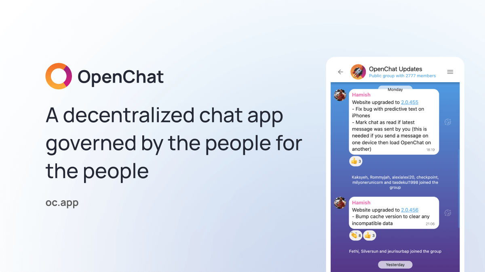
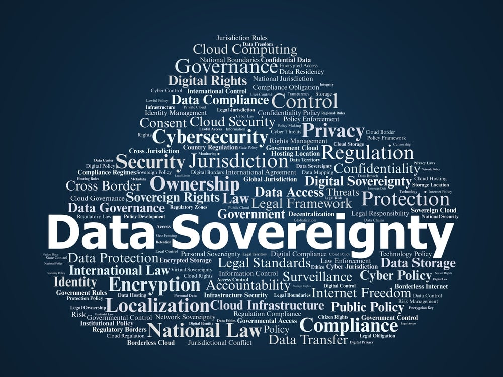

## The invasion of instant messengers

Our digital identity in 2026 is increasingly anchored by three pillars: **email**, **phone number**, and **credit card**. They define what we are (a human, not a bot) and who we are. Several of the most popular mainstream instant messaging (“IM") apps collect at least one of these three - usually the phone number. 

A phone number eventually leads to a government-issued ID and a credit card for payment. In many countries, getting a burner phone with cash is no longer an option. 

That’s a lot of personal information in the hands of the IM platform. 

I don’t like that. I don’t trust any of those platforms. I don’t want them to build a digital profile on me and sell me things - the predictable and profitable end-game for most of the consumer-facing apps. 

It’s not that I have something to hide. It’s just that I don’t want my private conversations with friends and family to be exposed to the watchful eyes of technology platforms that are built to mine consumer data en masse. In the past, they tried to monetize that data with ads. Now they all want to feed this data into the next frontier AI model that can slay the benchmark of the week.

The tech giants already know too much about us. In the first 15 years of the Internet (1995 - 2010), they achieved that with email. In the second 15 years (2010 - present), they nailed us with instant messengers. There is a reason why the biggest tech giants in either Silicon Valley (**Google**, **Meta**, **Microsoft**, **Amazon**) or China (**Alibaba**, **Tencent**, **Bytedance**) have remained largely the same cohort in the last 20 years. By knowing what we write and talk, they exert great influence on what we see and, at a more subconscious level, what we do.

I want independence. I want to have my own hands on the wheel. The tools should serve me, not control me.

## Slack + Telegram + Discord + WhatsApp in one app

[OpenChat (“OC")](https://oc.app/?ref=msogi-tiaaa-aaaaf-br7y4-xca), an IM social network built with blockchain technology, provides an interesting alternative. In the past few years, [I’ve referenced OC](https://herbertyang.xyz/public/) numerous times in many speeches, talks, panel discussions, and Twitter Spaces. While OC is well known in the vibrant ecosystem of the [Internet Computer (“IC”)](https://coinmarketcap.com/currencies/internet-computer/) among its users, developers, communities, and investors, as the single best demonstration of the superb decentralization technology from [IC](https://internetcomputer.org/), it’s still a very, very niche app for people outside of IC or in the broader crypto/Web3 world. 

So here’s a proper introduction to OpenChat. Since 2021, I’ve been using it almost daily in various project teams. I use other IMs, like **Signal**, **WhatsApp**, **WeChat**, and **Telegram**, out of obligation because I have to. I use OC because it excels at one thing. 

> It gives me all the IM features without knowing who I am

### Messaging

It’s a **WhatsApp**. You message other people if you know their handles. Its messaging features are on par with all the leading IMs. It supports **threaded replies**, **emoji reactions**, and **Markdown** syntax (all three are still missing from **WeChat**, by the way).  

Unlike WhatsApp, it does not know or collect your phone number.

### Groups

It’s a **Telegram**. You can create `groups` for only invited users or anyone with the QR code. You can create bots with `webhooks` to create event-based messages (for example, when a git CI run is finished). 

Unlike Telegram, it uses much more rigorous security authentication methods like passkeys and does not rely on sending a 6-digit code to your phone, which has been exploited frequently to hijack a Telegram account. 

### Communities

It’s a **Discord**. You can create `communities` for people who share the same interest (like hosting a server on Discord). Within a community, you can create channels with varied gates - some channels are for internal teams only; some are for all members of the community. These channels come with robust admin features to moderate member behaviors and contents. 

Unlike Discord, it’s fast and agile. Launching the Discord app on my MacBook Pro feels like lifting an elephant every time, and it takes forever. Discord is a powerful beast for the gaming and the Web3 crowds, but it’s painful to use and way too complex.

### Team Work

It’s a **Slack**. Your team doesn’t need an email system anymore. OC is a Progressive Web Application (“PWA") that runs on any client - desktop, mobile, iOS, or Android. Your instances on different devices are all in sync. 

Unlike Slack, OC is not running on any centralized server that might just know too much about the proprietary information for the next killer app your team is building. All your chats, groups, and communities are contained in canisters. [Canisters](https://docs.internetcomputer.org/concepts/canisters/) are the compute units of the Internet Computer blockchain that store your data (another form of smart contract). You are the only one who can access your canisters. Each canister has 13 replicas in the network of the Internet Computer. 

## The messenger that knows nothing

All these features are wonderful. OC is certainly capable, but how much does it know about you? 

> Nothing, really

### Authentication

OC uses [Internet Identity](https://docs.internetcomputer.org/guides/authentication/internet-identity/), a native authentication system for the Internet Computer to log in. Users sign in with passkeys (Face ID, a fingerprint, or a security key)) instead of passwords. It’s free, and you can sign up for as many Internet Identity accounts as you like. 

Internet Identity does not collect your phone number or email. Your Internet Identity is an anchor number that you can use to log into hundreds of thousands of Web3 apps built with the Internet Computer technology. 

Traditional tech platforms exploit your login credentials (email or WeChat ID) for invasive cross-selling without your permission (also creating an echo chamber for yourself). Your login ID gives you away. Your data becomes the meat for all the advertisers.

While Internet Identity (like `2571834`) enables you to log in to different IC apps, it generates a unique principal ID (like `ryjl3-tyaaa-aaaaa-aaaba-cai`) for each app to prevent cross-app tracking. So you have the benefit of using one single ID to authenticate in multiple apps but avoid the problem of exposing yourself to all these apps that leads to cross-tracking.

### Payment

OC has a straightforward usage-based pricing model. You pay for how much data you’re using (text, audio, videos, images in your chat groups) with [$CHAT](https://coinmarketcap.com/currencies/openchat/) tokens, which are issued by the OpenChat team. You can buy $CHAT on a centralized crypto exchange (“CEX") [Bitrue](https://www.bitrue.com/how-to-buy/chat) or a decentralized crypto exchange (“DEX") like [ICPSwap](https://www.icpswap.com/). 

There is no KYC (know-your-customer) when you pay with $CHAT. That’s the beauty of using cryptocurrencies. 

With a DEX, you can get $CHAT by swapping other cryptocurrencies like [$ICP](https://coinmarketcap.com/currencies/internet-computer/), which is issued by the [DFINITY Foundation](https://dfinity.org/), the developer lab that creates the Internet Computer, one of the leading Layer-1 blockchains. $ICP is a lot more accessible, as it is available from all major CEXs like **Binance** and **Coinbase**. Of course, you can also swap bitcoin/ethereum into $ICP. As for where to buy Bitcoin ([$BTC](https://coinmarketcap.com/currencies/bitcoin)), you can refer to this 2026 guide - [Where to Buy BTC](https://digitalsovereignty.herbertyang.xyz/p/where-to-buy-bitcoin-in-2026/).

### Sovereignty

Data sovereignty does not exist in any current traditional tech platforms. 

You’re just leasing a room from them, placing your stuff in this room, and gradually growing the stock. The platforms can take back the room anytime they want. Very often they don’t even bother to provide an explanation. If they do, it’s along the lines of “your account has suspicious activity, so we freeze it”. You’re always welcome to call their customer hotline and will be in luck if you can get to a human within 15 minutes. 

With OpenChat, your data stays safe and secure in a canister that is deployed on a [decentralized blockchain](https://digitalsovereignty.herbertyang.xyz/p/decoding-the-crypto-ecosystem-ep01-blockchains/). Nobody can access the contents of this canister but you. There is no `root` on the OpenChat network or the network of the Internet Computer. OpenChat is [open source](https://github.com/open-chat-labs), hosted in public on **GitHub**,  and governed by a community-run governance system ([the OpenChat DAO](https://oc.app/whitepaper)) on the Internet Computer. 

The DAO is open to anyone who holds the $CHAT tokens. As a user and investor of $CHAT, you can participate in the governance of the OpenChat development, such as its product roadmap and reward system. 

The founders of OpenChat, the three British developers, are not the CEO/CTO of OpenChat. They are core developers of OpenChat and are employed by the DAO to continue the work to grow its adoption. If they want to take a few days off on a beach, the DAO can recruit other developers to fill in for them. All the users of OpenChat and holders of $CHAT have an aligned, collective incentive to grow the community. With more users, there will be more demand for $CHAT, $CHAT’s price will rise, and everybody will be better off.

## The future of Web3?

OpenChat is a good example of what **blockchain** can do - it can run web applications, providing the same product features but deploying on decentralized infrastructure that does not have a single point of failure or surrender its power to a super-admin. 

It is also a great demonstration of what **Web3** should look like - how to align interests between developers and early adopters; how to turn users into investors and owners with decentralized ownership; and how to return data ownership back to the users. 

There are many such Web3 apps in the ecosystem of the Internet Computer, but OpenChat is one of the earliest and has survived the ups and downs of crypto in the last few years. I wish more friends could be there, especially the Chinese. 

**WeChat** is a fairly appalling IM with inferior functionality that is behind all other global IMs (**Signal**, **WhatsApp**, **Telegram**, **Line**, **Kakao**, **Facebook Messenger**) by at least 5-8 years. There is little incentive for **Tencent** to improve WeChat because every Chinese is already a slave to it, and few ever imagine there could be something better out there. For the vast majority of Chinese and a whole generation, WeChat is the Internet. This is pretty sad.

Give me a yell at [https://oc.app/chats/user/msogi-tiaaa-aaaaf-br7y4-xca](https://oc.app/chats/user/msogi-tiaaa-aaaaf-br7y4-xca), and I will see you on the other side.